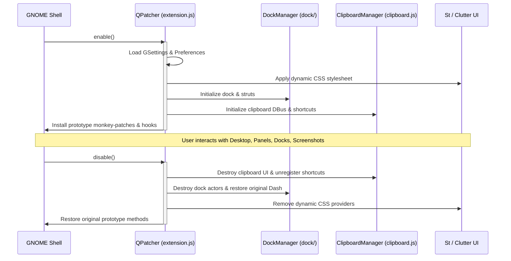
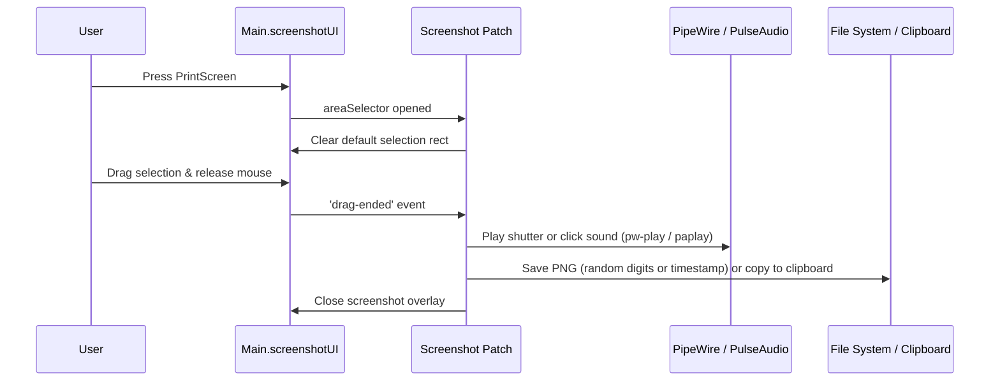

# QPatcher Architecture & Extension Development Memo (AGENTS.md)

Technical architectural memo and guide for developing, maintaining, and extending **QPatcher** — the all-in-one desktop customization, UI perfection, and enhancement suite for **GNOME Shell 45–51** (native ESM JavaScript / GJS architecture).

---

## 1. Architectural Overview & Philosophy

QPatcher is engineered as a **self-contained, unified GNOME Shell customization suite**. Instead of deploying multiple overlapping and conflicting third-party extensions, QPatcher consolidates desktop refinements into a single cohesive, high-performance package directly integrated into the GNOME Shell JavaScript / Clutter runtime:

- **100% Standalone:** Zero external extension dependencies. All dock, panel, notification, screenshot, clipboard, and theming features run natively within QPatcher.
- **Zero-Leak Lifecycle:** Every Clutter actor, GObject signal handler, CSS provider, D-Bus export, and monkey-patched prototype method cleanly disconnects and unwinds when `disable()` is called.
- **Performance-First:** Heavy operations (such as multi-monitor wallpaper blurring) leverage hardware-accelerated Clutter actor cloning (`Shell.BlurMode.ACTOR`) rather than CPU-bound background sampling, ensuring 60–144 FPS smoothness across Wayland and X11 sessions.
- **Strict English Localization:** All source code, preferences UI, schemas, and notifications are natively maintained in English according to GNOME Human Interface Guidelines (HIG).

---

## 2. Component Subsystems

### 2.1. Top Bar Subsystem
- **Multi-Monitor Routing:** Relocates the top panel (`Main.layoutManager.panelBox`) to any physical monitor using geometry overrides and layout constraints.
- **Fullscreen Visibility:** Keeps the top panel visible even when applications and video players run in fullscreen mode.
- **Dynamic Theming & Opacity:** Injects dynamic CSS classes (`#panel.qpatcher-topbar-theme`) with customizable background color and opacity slider (0% to 100%).
- **Transparent in Overview:** Smoothly fades out the top panel background when opening the Overview using CSS transitions (`transition: background-color 250ms ease-out`).
- **Uppercase Input Source:** Monkey-patches `Keyboard.InputSourceIndicator` to enforce uppercase language indicators (`RU`, `EN`) persistently across session modes.
- **Clock Customization:** Configurable day of the week, seconds display, and granular visibility toggles for all panel elements.

### 2.2. Integrated Dock Subsystem
- **Embedded Engine:** Self-contained dock engine located in `dock/` with `DockManager`, eliminating any requirement for external `dash-to-dock`.
- **Desktop Struts & Intellihide:** Reserves screen space at the chosen screen edge, or dynamically auto-hides when overlapped by application windows.
- **Center-Pivot Magnification:** Magnifies icons smoothly from center pivot `(0.5, 0.5)` to `1.15x` on hover without vertical clipping against parent container bounds.
- **Notification Badges:** Circular pill geometry with white glass borders and optional accent coloring, replacing awkward rectangular counters.
- **Running Indicators:** Sleek horizontal accent bar under active apps instead of cluttered dots.
- **Storage & Mounts:** Automatic detection and display of mounted USB flash drives and external disks via GIO volume monitors.

### 2.3. Overview & Window Controls
- **Multi-Monitor Wallpaper Blur:** Clones active desktop wallpapers across all connected displays using `Clutter.Clone` and applies `Shell.BlurEffect({ mode: Shell.BlurMode.ACTOR })`.
- **Window Controls Cleanup:** Granular options to hide window close buttons, application icons, and window titlebars in overview mode.
- **Search & Workspace Controls:** Independent visibility toggles for the overview search bar and workspace thumbnail picker.

### 2.4. Notifications & DateMenu (Notification Center)
- **Symmetry Correction:** Eliminates GNOME's legacy 22px right gap when the calendar column is hidden, centering notification cards and the "Clear All" button.
- **Banner Routing:** Routes popup notifications to any physical display with configurable horizontal alignment (Center, Left, Right).
- **Banner Customization:** Option to hide close button (X), hide top bar bell icon, and configure auto-dismiss timeouts.
- **OSD Routing:** Directs volume and brightness on-screen displays to a chosen monitor instead of mirroring across all screens.

### 2.5. Quick Settings
- **Odd-Tile Full Width:** Dynamically balances the quick toggle grid by stretching the last unpaired tile across two columns (`columnSpan = 2`).
- **Persistent Grid Hooking:** Monitors `open-state-changed` and `actor-added` signals to maintain balanced geometry when Bluetooth or Wi-Fi devices connect.
- **System Buttons:** Granular visibility toggles for circular utility buttons (Power, Lock, Settings, Screenshot).

### 2.6. Native Screenshot Interception Engine
- **In-Memory Capture Pipeline:** Intercepts `Main.screenshotUI._saveScreenshot` to route through a custom compositing and storage workflow.
- **Clean Selection Start:** Resets default pre-selected rectangles on open, allowing immediate clean drag selections.
- **Drag-to-Capture:** Automatically captures the selected area immediately upon mouse release without requiring an Enter press.
- **Direct Low-Latency Audio:** Plays shutter sounds or neutral bubble clicks directly via PipeWire (`pw-play`) or PulseAudio (`paplay`), bypassing system libcanberra issues.
- **Flexible Naming:** Supports 6 random digits (`123456.png`), ISO timestamps (`2026-10-25_16.05.30.png`), or default GNOME filenames.
- **Storage Options:** Saves directly into `~/Pictures` or to clipboard only without cluttering disk storage.

### 2.7. Integrated Clipboard History & Emoji Picker
- **Dual-Tab Interface:** Streamlined popup containing strictly Clipboard History and an Emoji Picker.
- **Global Shortcuts:** Default bindings for `<Super>v` (Clipboard History) and `<Super>period` (Emoji Picker).
- **Rich Content Support:** Stores and previews text and PNG images with thumbnails, dimensions, and timestamps.
- **Auto-Paste Simulation:** Simulates `Shift+Insert` via virtual input device upon selecting an item or emoji.
- **Persistence Across Reboots:** Keeps history safely on disk by default, with an optional toggle to clear unpinned items on system boot.
- **Bilingual Emoji Search:** Searches emojis in Russian and English with prioritized digit/number emojis.
- **Universal Select All:** Supports full Ctrl + A across both English (`0x61`) and Russian (`0x6c6`) keyboard layouts.

### 2.8. Appearance & Lock Screen
- **Unified Theme Color:** Centralizes dark background palettes (Charcoal, Graphite, Slate Blue, Nord Dark, Obsidian) or custom HEX colors across all menus, dialogs, and panels.
- **Keep Monitors Awake (Win+L):** Prevents displays from blanking or entering sleep mode when locking the session.
- **Direct Password Prompt:** Bypasses the lock screen curtain to immediately focus the password entry.
- **Single-User Auto-Select:** Automatically focuses the single system user on the login screen.

---

## 3. Communication & Lifecycle Architecture

### Extension Lifecycle



### Screenshot Interception Pipeline



---

## 4. Codebase Structure

```text
QPatcher/
├── dock/                               # Integrated standalone dock engine
│   ├── docking.js                      # Core dock manager and lifecycle
│   ├── theming.js                      # Dock theming, colors, and transparency
│   ├── locations.js                    # Removable drives, trash, and mounts
│   └── ...                             # Dock helper modules
├── schemas/                            # GSettings XML schemas
│   ├── org.gnome.shell.extensions.qpatcher.gschema.xml
│   └── org.gnome.shell.extensions.dash-to-dock.gschema.xml
├── screenshots/                        # High-resolution UI showcase images
│   ├── 01_topbar.png
│   ├── 02_dock.png
│   ├── 03_overview.png
│   ├── 04_notifications.png
│   ├── 05_datemenu.png
│   ├── 06_quicksettings.png
│   ├── 07_screenshots.png
│   ├── 08_clipboard.png
│   └── 09_appearance.png
├── sounds/                             # Shutter and click audio assets
│   ├── click.ogg
│   └── shutter.ogg
├── clipboard.js                        # Clipboard history and emoji picker engine
├── emoji_data.json                     # Bilingual emoji metadata database
├── extension.js                        # Main GNOME Shell extension lifecycle & runtime hooks
├── metadata.json                       # Shell extension metadata (UUID, version, shell-version)
├── prefs.js                            # Adwaita preferences window (9 organized tabs)
├── preview.js                          # Standalone GTK4 / Adwaita GUI previewer for testing
├── stylesheet.css                      # Static stylesheets for GNOME Shell widgets
├── LICENSE                             # MIT License
├── AGENTS.md                           # Technical architecture memo & guidelines
└── README.md                           # Public documentation & interface preview
```

---

## 5. Development & Maintenance Guidelines

### Schema Compilation
When modifying XML schema files, always recompile schemas locally:

```bash
cd schemas/
glib-compile-schemas .
cp *.xml ~/.local/share/glib-2.0/schemas/
glib-compile-schemas ~/.local/share/glib-2.0/schemas/
```

### Standalone Preferences Testing
You can preview the Adwaita preferences window directly without opening GNOME Extensions or reloading the shell:

```bash
gjs -m preview.js
```

### Syntax Validation
Validate JavaScript files using Node.js or GJS before committing:

```bash
node -c extension.js prefs.js preview.js clipboard.js
```

### D-Bus Interface Invocation
Test external triggers for the clipboard and emoji picker:

```bash
# Toggle Clipboard History:
gdbus call --session --dest org.gnome.Shell --object-path /org/gnome/Shell/Extensions/QPatcher --method org.gnome.Shell.Extensions.QPatcher.ToggleClipboard

# Toggle Emoji Picker:
gdbus call --session --dest org.gnome.Shell --object-path /org/gnome/Shell/Extensions/QPatcher --method org.gnome.Shell.Extensions.QPatcher.ToggleEmoji
```

### Commit Conventions
Write clear, concise commit messages in **English** using conventional prefixes:
- `feat: ...` for new features or capabilities
- `fix: ...` for bug fixes and UI corrections
- `style: ...` for CSS and layout improvements
- `refactor: ...` for internal structural optimizations
- `docs: ...` for documentation and metadata updates

---

## 6. GitHub Release Formatting Standard

All GitHub releases across the repository **must strictly adhere to the following unified English format**. Never include filler phrases, extraneous prose, or unlinked changelogs. Emojis must not be used in release titles or headers.

### Release Body Template

```markdown
### What's New
- Concise bulleted summary of new features, optimizations, and UI enhancements.
- Second key change.
- Third key change.

[Full Changelog](https://github.com/Qyzom/QPatcher/commits/main)

### Installation
Clone the repository or extract the release archive into your GNOME Shell extensions directory:

```bash
git clone https://github.com/Qyzom/QPatcher.git ~/.local/share/gnome-shell/extensions/qpatcher@qybic
cd ~/.local/share/gnome-shell/extensions/qpatcher@qybic
glib-compile-schemas schemas/
gnome-extensions enable qpatcher@qybic
```
```

### Release Rules & Workflow:
1. **Language:** Always 100% in **English**.
2. **Typography:** Do not use emojis in release titles, headers, or bullet points.
3. **"What's New" Section:** Keep it concise and bulleted (3–7 bullets maximum). Focus on tangible user-facing value and GNOME Shell compatibility.
4. **Changelog Link:** The link between the sections must strictly be `[Full Changelog](https://github.com/Qyzom/QPatcher/commits/main)`.
5. **Tag Naming Convention:** Always tag releases as `vX.X.X` (e.g. `v1.0.0`).
6. **Metadata Synchronization:** Ensure `metadata.json` has matching `"version"` integer and `"version-name"` string before creating the release.
